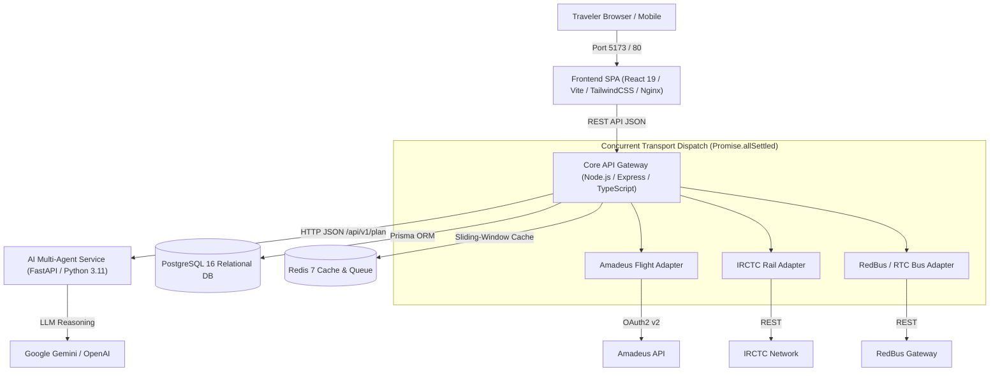

# Safar Saarthi (सफ़र सारथी)

[](https://github.com/sabuj-dey/safar-saarthi/actions/workflows/ci.yml)
[](https://nodejs.org/)
[](https://python.org/)
[](https://www.postgresql.org/)
[](https://www.docker.com/)
[](https://opensource.org/licenses/MIT)

> **Autonomous Multi-Modal Travel Intelligence & Multi-Agent Planning Platform for India**

Safar Saarthi unifies **Indian Railways (IRCTC trains)**, **domestic airlines**, and **intercity buses** into a single, transparent comparative matrix. It calculates true door-to-door journey costs (including cab transfers and baggage), deterministically identifies **Cheapest**, **Fastest**, and **Best-Value** routes, and coordinates an autonomous 5-agent AI network to build feasible, culture-aware day-wise itineraries.

---

## 📑 Table of Contents
1. [Core Features](#-core-features)
2. [System Architecture & Data Flow](#-system-architecture--data-flow)
3. [Technology Stack](#-technology-stack)
4. [System Requirements](#-system-requirements)
5. [Quickstart: Single-Command Deployment (Docker)](#-quickstart-single-command-deployment-docker)
6. [Manual Local Development Setup](#-manual-local-development-setup)
7. [Database Setup & Migrations](#-database-setup--migrations)
8. [External Provider Integration Setup](#-external-provider-integration-setup)
9. [AI Specialist Service & LLM Configuration](#-ai-specialist-service--llm-configuration)
10. [Automated Testing Suite](#-automated-testing-suite)
11. [REST API Documentation](#-rest-api-documentation)
12. [Resilience, Security & Hardening](#-resilience-security--hardening)
13. [Limitations & Future Scope](#-limitations--future-scope)
14. [Documentation & Viva Materials](#-documentation--viva-materials)

---

## 🌟 Core Features

- **Multi-Modal Transport Comparison**: Compare Flights, IRCTC Trains, and Intercity Buses side-by-side across major Indian travel corridors.
- **Deterministic Journey Ranking**: Mathematically sorts routes into `CHEAPEST`, `FASTEST`, and `BEST_VALUE` without relying on probabilistic LLM arithmetic.
- **Full Door-to-Door Cost Model**: Calculates ticket fares, mandatory government/airport taxes, first-mile/last-mile cab transfers, and station connection fees.
- **5-Agent AI Orchestration Network**:
  1. *Trip Coordinator Agent*: Interprets requests and validates mandatory trip constraints.
  2. *Transport Recommendation Agent*: Contextualizes transit trade-offs.
  3. *Accommodation Agent*: Selects verified stays based on hub proximity.
  4. *Activities Agent*: Curates monument visits and operating hours.
  5. *Budget & Constraint Agent*: Enforces 45-minute transit exit buffers, detects budget deficits, and suggests savings.
- **Anti-Backtracking Spatial Engine**: Pairwise Haversine distance calculations ensure daily sightseeing follows a linear geographical corridor.
- **Secure Accounts & Private Itineraries**: Scrypt password hashing, HMAC-SHA256 JWT tokens, constant-time verification, and single-click trip duplication.
- **Open-Redirect & Deep-Link Sanitization**: Restricts redirection strictly to official provider domains (`irctc.co.in`, `goindigo.in`, `airindia.com`, `redbus.in`, `makemytrip.com`) and strips sensitive auth tokens.

---

## 🏛 System Architecture & Data Flow



For full architectural diagrams, see:
- [System Architecture Diagram](docs/ARCHITECTURE_DIAGRAM.md)
- [Entity-Relationship (ER) Diagram](docs/ER_DIAGRAM.md)
- [Data-Flow Diagrams (Level 0 & Level 1)](docs/DATA_FLOW_DIAGRAM.md)
- [Multi-Modal Sequence Diagram](docs/SEQUENCE_DIAGRAM.md)
- [Use-Case Diagram](docs/USE_CASE_DIAGRAM.md)

---

## 💻 Technology Stack

| Layer | Technologies |
|:---|:---|
| **Frontend** | React 19, TypeScript 5.7, Vite 6, Tailwind CSS 3.4, Lucide Icons |
| **Backend Gateway** | Node.js 20+, Express 4.21, TypeScript 5.7, Prisma 6.4, Zod 3.24 |
| **AI Specialist Service** | Python 3.11/3.13, FastAPI 0.115, Pydantic v2, Uvicorn, HTTPX |
| **Databases & Cache** | PostgreSQL 16 (Relational data), Redis 7 (Rate limiting & cache) |
| **Testing Harness** | Vitest 3.2 (Unit & Integration), Pytest 9.1 (AI Agents), Playwright 1.64 (E2E) |
| **Container & Web Server** | Docker (Multi-stage builds), Docker Compose, Nginx (Alpine) |

---

## ⚙️ System Requirements

- **Node.js**: `v20.12.0` or higher (LTS recommended)
- **npm**: `v10.0.0` or higher
- **Python**: `v3.11` or `v3.13`
- **Docker**: `v24.0+` & Docker Compose `v2.20+` (optional for containerized deployment)
- **PostgreSQL**: `v16.0+` (local or via Docker)

---

## 🚀 Quickstart: Single-Command Deployment (Docker)

The fastest and most reproducible way to launch the entire production stack:

### On Linux / macOS:
```bash
git clone https://github.com/sabuj-dey/safar-saarthi.git
cd safar-saarthi
chmod +x deploy.sh
./deploy.sh
```

### On Windows (PowerShell):
```powershell
git clone https://github.com/sabuj-dey/safar-saarthi.git
cd safar-saarthi
.\deploy.ps1
```

### What this does:
1. Validates prerequisites and creates `.env` from `.env.example`.
2. Builds lightweight multi-stage Docker images for Frontend, Backend, and AI Service.
3. Starts PostgreSQL 16 and Redis 7 and waits for health probes to turn green.
4. Automatically runs Prisma migrations (`prisma migrate deploy`) and seeds initial benchmark providers, stays, and places (`prisma:seed`).
5. Launches all services on dedicated internal Docker networks.

### Service URLs:
- **Frontend SPA**: [http://localhost:5173](http://localhost:5173) (or `http://localhost`)
- **Backend API Gateway**: [http://localhost:5000](http://localhost:5000)
- **Backend Health Check**: [http://localhost:5000/health](http://localhost:5000/health)
- **AI Specialist Service**: [http://localhost:8000/health](http://localhost:8000/health)
- **AI Swagger API Docs**: [http://localhost:8000/docs](http://localhost:8000/docs)

---

## 🛠 Manual Local Development Setup

If developing locally without Docker:

### 1. Install Monorepo Dependencies
```bash
npm install
```

### 2. Start PostgreSQL & Redis
Using the development Docker Compose:
```bash
docker compose -f docker-compose.dev.yml up -d
```
*(Or point `DATABASE_URL` in `backend/.env` to an existing PostgreSQL 16 instance)*

### 3. Setup Database & Seed Initial Data
```bash
npm run prisma:generate --workspace=backend
npm run prisma:migrate --workspace=backend
npm run prisma:seed --workspace=backend
```

### 4. Setup and Run AI Specialist Service
```bash
cd ai-service
python -m venv .venv

# On Windows:
.venv\Scripts\activate
# On Linux/macOS:
source .venv/bin/activate

pip install -r requirements.txt
python -m uvicorn app.main:app --reload --port 8000
```

### 5. Run Backend Gateway (New Terminal)
```bash
npm run dev:backend
# Listening on http://localhost:5000
```

### 6. Run Frontend Application (New Terminal)
```bash
npm run dev:frontend
# Accessible at http://localhost:5173
```

---

## 🗄 Database Setup & Migrations

Safar Saarthi uses Prisma ORM on PostgreSQL with strict schema definitions for Trips, Transport Offers, Providers, Itineraries, Places, and Users.

```bash
# Generate Prisma Client
npm run prisma:generate --workspace=backend

# Run development migrations (with interactive prompt)
npm run prisma:migrate --workspace=backend

# Deploy migrations in production (non-interactive)
npm run prisma:deploy --workspace=backend

# Seed benchmark Indian travel data (Providers, Hotels, Monuments)
npm run prisma:seed --workspace=backend

# Open visual database browser
npm run prisma:studio --workspace=backend
```

---

## 🔌 External Provider Integration Setup

Safar Saarthi operates in a hybrid mode: it connects to real-world live APIs when credentials are provided and gracefully falls back to authentic Indian travel benchmarks when credentials are left blank.

### 1. Amadeus for Developers (Domestic Flights)
1. Register for a free account at [developers.amadeus.com](https://developers.amadeus.com/).
2. Create an application to get your API Key and Secret (Self-Service tier includes 2,000 free monthly test calls).
3. Set variables in `backend/.env`:
   ```ini
   AMADEUS_CLIENT_ID="your_client_id"
   AMADEUS_CLIENT_SECRET="your_client_secret"
   AMADEUS_ENV="test" # "test" or "production"
   ```

### 2. Indian Railways (IRCTC / Rail Gateway)
- Set variables in `backend/.env`:
  ```ini
  IRCTC_API_KEY="your_api_key" # RapidAPI or authorized CRIS gateway
  ```
- *Security Note*: Safar Saarthi redirects users to the official `irctc.co.in` deep-link and **never** requests or stores users' IRCTC passwords.

### 3. Intercity Buses (RedBus / State RTCs)
- Set variables in `backend/.env`:
  ```ini
  REDBUS_API_KEY="your_api_key"
  ```

---

## 🤖 AI Provider Configuration

The AI Multi-Agent Service (`ai-service`) supports Google Gemini, OpenAI, or a deterministic Mock provider (ideal for testing and offline development).

Configure in `ai-service/.env`:
```ini
# Choose provider: "mock", "gemini", or "openai"
LLM_PROVIDER="gemini"

# For Google Gemini (Recommended):
GEMINI_API_KEY="your_gemini_api_key"
GEMINI_MODEL="gemini-1.5-flash"

# For OpenAI:
OPENAI_API_KEY="your_openai_api_key"
OPENAI_MODEL="gpt-4o-mini"
```

---

## 🧪 Automated Testing Suite

The codebase has undergone exhaustive testing across all tiers:

```bash
# 1. Run all 11 Backend Vitest Suites (137 tests)
npm run test --workspace=safar-saarthi-backend

# 2. Run AI Specialist Service Pytest Suites (22 tests)
cd ai-service && pytest -v

# 3. Run Playwright End-to-End Browser Tests (9 scenarios)
npx playwright test --project=chromium

# 4. Run TypeScript Typechecking Across All Packages
npm run typecheck

# 5. Build Production Frontend Bundle
npm run build --workspace=frontend
```

See [Testing and Results Report](docs/TESTING_RESULTS.md) for detailed test metrics and logs.

---

## 📡 REST API Documentation

Base URL: `http://localhost:5000/api/v1`

| Area | Method | Endpoint | Description |
|:---|:---|:---|:---|
| **Health** | `GET` | `/health`, `/api/v1/health` | Service liveness, DB connection latency, and uptime. |
| **Trips** | `POST` | `/api/v1/trips/search` | Search and rank multi-modal transport options. |
| **Trips** | `GET` | `/api/v1/trips/:id` | Retrieve trip details and associated transport offers. |
| **Itinerary** | `POST` | `/api/v1/ai/generate-itinerary` | Trigger multi-agent pipeline to generate day-wise itinerary. |
| **Auth** | `POST` | `/api/v1/auth/register` | Create user account with persona preferences. |
| **Auth** | `POST` | `/api/v1/auth/login` | Authenticate user and receive signed JWT. |
| **User** | `GET` | `/api/v1/users/me/profile` | Retrieve authenticated traveler profile. |
| **Saved Trips**| `GET` | `/api/v1/users/me/saved-trips` | Fetch private bookmarked trips. |
| **Saved Trips**| `POST` | `/api/v1/users/me/saved-trips` | Save an itinerary plan. |
| **Saved Trips**| `POST` | `/api/v1/users/me/saved-trips/:id/duplicate` | Duplicate an existing saved itinerary. |
| **Places** | `GET` | `/api/v1/places/search?city=Jaipur`| Discover destination attractions with opening hours. |

---

## 🔒 Resilience, Security & Hardening

- **Scrypt Password Hashing**: Passwords derived using unique 16-byte cryptographically secure salts.
- **Timing-Safe Operations**: Token and password checks use `crypto.timingSafeEqual` to thwart timing attacks.
- **Strict CORS & Size Limits**: Strict origin allowlisting and `1mb` maximum JSON payload body limits.
- **Rate Limiting**: Sliding-window rate limiting on all `/api` endpoints (120 req/min) and auth endpoints.
- **Security Headers**: Enforces `X-Frame-Options: DENY`, `X-Content-Type-Options: nosniff`, and `Strict-Transport-Security`.
- **Fault-Isolated Dispatch**: `Promise.allSettled` ensures upstream provider timeouts never crash overall searches.

---

## ⚠️ Limitations & Future Scope

| Status | Capability | Notes |
|:---|:---|:---|
| ✅ **Implemented** | Multi-Modal Comparison | Deterministic Cheapest / Fastest / Best-Value ranking. |
| ✅ **Implemented** | Multi-Agent AI Itineraries | Day-wise planning with transit buffers and anti-backtracking. |
| ✅ **Implemented** | User Accounts & Duplication| Scrypt password hashing and private trip management. |
| ⚠️ **Provider-Dependent** | Live Amadeus Flights | Requires API keys; falls back to verified benchmarks if unset. |
| ⚠️ **Provider-Dependent** | Direct IRCTC Seat Booking | IRCTC legal policy restricts 3rd-party purchasing; provides official deep-link redirection. |
| 🔮 **Planned Future** | WhatsApp Travel Assistant | Receive itineraries and train delay push notifications via WhatsApp. |
| 🔮 **Planned Future** | Group Collaborative Editing| Multi-user real-time planning via WebSockets. |

See [Limitations & Future Scope](docs/LIMITATIONS_AND_FUTURE_SCOPE.md) for full details.

---

## 📚 Documentation & Viva Materials

Comprehensive academic and interview documentation is available in [`docs/`](docs/):
- **[System Architecture Diagram](docs/ARCHITECTURE_DIAGRAM.md)**: Detailed diagram of multi-tier services and data flows.
- **[Entity-Relationship Diagram](docs/ER_DIAGRAM.md)**: Complete PostgreSQL Prisma data model.
- **[Data-Flow Diagrams](docs/DATA_FLOW_DIAGRAM.md)**: Level 0 and Level 1 DFDs.
- **[Sequence Diagram](docs/SEQUENCE_DIAGRAM.md)**: Interaction sequence for multimodal search and AI planning.
- **[Use-Case Diagram](docs/USE_CASE_DIAGRAM.md)**: Functional actor and use-case matrix.
- **[Testing Results Chapter](docs/TESTING_RESULTS.md)**: Test metrics, logs, and coverage reports.
- **[Backup & Recovery Guide](docs/BACKUP_AND_RECOVERY.md)**: Database backup, disaster recovery, and migration rollback runbooks.
- **[Demonstration Script](docs/DEMO_SCRIPT.md)**: 5-to-10 minute live presentation guide.
- **[Viva Questions & Answers](docs/VIVA_QA.md)**: Comprehensive answers for defense and technical interviews.
- **[Resume Bullet Points](docs/RESUME_POINTS.md)**: Production-ready resume descriptions and skill keywords.

---

## 📄 License
This project is licensed under the MIT License — see the [LICENSE](LICENSE) file for details.
