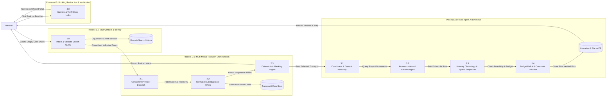

# Safar Saarthi — Data-Flow Diagrams (DFD)

This document specifies the Data-Flow Diagrams (DFD) for the Safar Saarthi platform, illustrating how travel queries, credentials, provider telemetry, and synthesized itineraries flow through the system.

---

## 1. DFD Level 0 — Context Diagram

```mermaid
flowchart TD
    Traveler["Traveler / User"]
    SafarSaarthi["0.0<br>Safar Saarthi Multi-Agent System"]
    AirlineAPIs["External Airline Providers<br>(Amadeus / Air India / IndiGo)"]
    RailwayAPIs["External Rail Gateways<br>(IRCTC / CRIS Networks)"]
    BusAPIs["External Bus Aggregators<br>(RedBus / State RTCs)"]
    PlacesStayAPIs["Accommodations & Places<br>(MakeMyTrip / Zostel / OSM)"]
    LLMProvider["LLM Reasoning Engine<br>(Gemini / OpenAI)"]

    Traveler -->|1. Travel Query (Origin, Dest, Dates, Travelers, Budget)| SafarSaarthi
    Traveler -->|2. Authentication & Preferences (Pace, Style, Dietary)| SafarSaarthi

    SafarSaarthi -->|3. Flight Search Request (Origin, Dest, DepDate)| AirlineAPIs
    AirlineAPIs -->|4. Flight Tariffs & Schedules| SafarSaarthi

    SafarSaarthi -->|5. Train Timetable & Route Query| RailwayAPIs
    RailwayAPIs -->|6. Train Availability & Fares| SafarSaarthi

    SafarSaarthi -->|7. Intercity Bus Query| BusAPIs
    BusAPIs -->|8. Bus Schedules & Boarding Points| SafarSaarthi

    SafarSaarthi -->|9. Destination & Hub Coordinates| PlacesStayAPIs
    PlacesStayAPIs -->|10. Hotel Options & Verified Monuments| SafarSaarthi

    SafarSaarthi -->|11. Synthesize Itinerary Context & Constraints| LLMProvider
    LLMProvider -->|12. Reasoning & Recommendations| SafarSaarthi

    SafarSaarthi -->|13. Unified Comparison (Cheapest, Fastest, Best-Value)| Traveler
    SafarSaarthi -->|14. Day-Wise Feasible AI Itinerary + Map Routes| Traveler
    SafarSaarthi -->|15. Verified Deep-Link Redirection to Official Portals| Traveler
```

---

## 2. DFD Level 1 — Detailed Subsystem Decomposition


