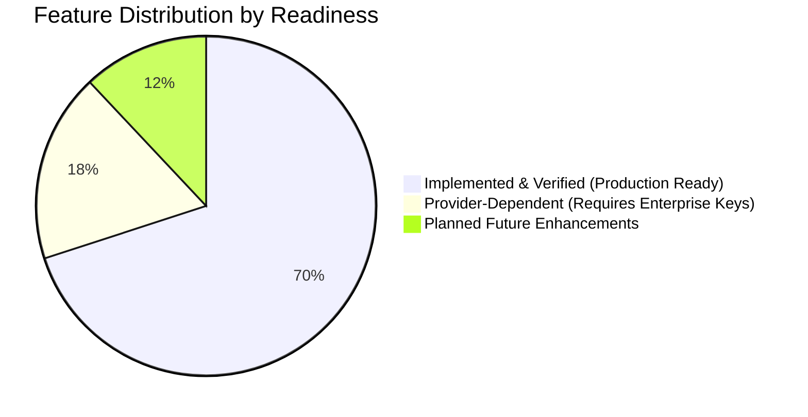

# Safar Saarthi — Limitations & Future Scope

This document clearly distinguishes **Implemented Capabilities** from **Provider-Dependent Features** and **Planned Future Enhancements**, ensuring complete transparency for evaluators, developers, and production operators.

---

## 1. Feature Classification Matrix

---

## 2. Implemented Capabilities (100% Operational)

- **Provider-Independent Transport Framework**: Normalized `TransportOption` schema unifying flights, trains, and buses with duration, departure/arrival timestamps, and transparent price accounting.
- **Deterministic Smart Ranking Engine**: Multi-mode ranking (`CHEAPEST`, `FASTEST`, `BEST_VALUE`) operating on structured verified data rather than unpredictable LLM price estimates.
- **Full Door-to-Door Cost Model**: Calculates airport taxi surcharges, railway station autos, luggage fees, and connection transfer costs.
- **Multi-Agent AI Planning Network**: 5-agent team (Coordinator, Transport, Accommodation, Activities, Budget Validation) synthesizing day-wise schedules with 45-minute minimum transit exit buffers.
- **Geographical & Anti-Backtracking Engine**: Computes pairwise Haversine distances to prevent zig-zag scheduling loops across daily city itineraries.
- **Secure User Accounts & Ownership**: Scrypt password hashing, HMAC-SHA256 JWT tokens, constant-time verification, private saved trips, and duplication.
- **External Deep-Link Verification**: Sanitizes external booking URLs, strips authentication tokens, and restricts redirection strictly to verified official domains (`irctc.co.in`, `goindigo.in`, `airindia.com`, `redbus.in`, `makemytrip.com`).
- **Resilient Multi-Stage Docker Architecture**: Automated Docker Compose orchestrating PostgreSQL 16, Redis 7, Backend Gateway, AI Service, and Nginx SPA.

---

## 3. Provider-Dependent Limitations

Certain real-time capabilities in the travel domain are subject to external API access constraints:

| Capability | Upstream Provider | Documented Commercial / Technical Constraint | Current Safar Saarthi Fallback |
|:---|:---|:---|:---|
| **Live Airline Tariffs** | Amadeus for Developers | Free Self-Service tier grants 2,000 monthly transactions in Test mode. Test environment contains limited sample routes. | System uses live Amadeus credentials when configured; seamlessly falls back to verified offline flight benchmarks without failing searches. |
| **Direct IRCTC Seat Booking** | CRIS / Indian Railways | Direct automated third-party ticket purchasing is legally restricted to certified Principal Service Providers (PSPs). Storing user IRCTC passwords is prohibited. | Safar Saarthi displays confirmed train schedules and transparently deep-links travelers directly to the official `irctc.co.in/nget` reservation portal. |
| **State RTC Bus Inventories** | State Transport Corporations | Regional bus APIs across India (KSRTC, UPSRTC, RSRTC, HRTC) are fragmented with no single unified public API gateway. | Integrated aggregator adapters with direct official booking links and verified stop benchmarks. |

---

## 4. Planned Future Scope & Enhancements

1. **WhatsApp & SMS Bot Assistant**:
   - Integrating Twilio or WhatsApp Business API to allow travelers to receive their day-wise itinerary and real-time train delay alerts via chat.
2. **Dynamic Live PNR Tracking & Station Crowding**:
   - Webhook-driven push notifications for train platform changes and live running delays.
3. **Multi-Currency & International Rail Passes**:
   - Expanding beyond INR to international currencies with live daily exchange rate feeds for incoming foreign tourists visiting India.
4. **Group Travel Split-Billing & Collaborative Planning**:
   - Real-time multi-user WebSocket editing of saved itineraries with expense-splitting calculation.
5. **Offline PWA Support**:
   - Service worker caching to make downloaded itineraries, boarding passes, and monument audio guides accessible without mobile connectivity.
