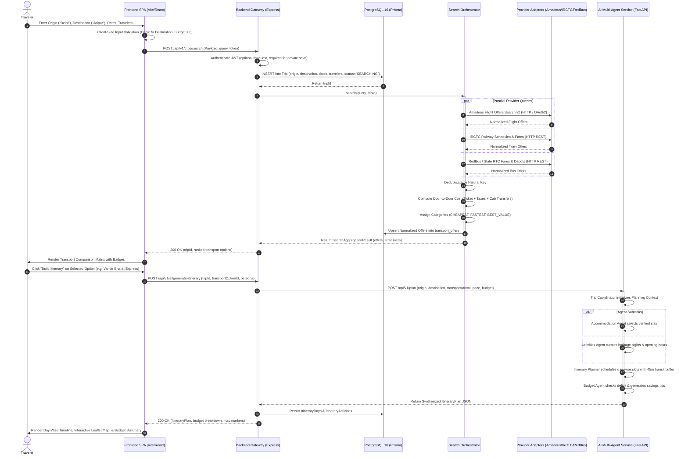

# Safar Saarthi — Sequence Diagram (Multi-Modal Search & Itinerary)

The following sequence diagram details the end-to-end interactions between the Traveler, Frontend React SPA, Backend API Gateway, Transport Search Orchestrator, Provider Adapters, PostgreSQL, and the AI Multi-Agent Specialist Service.

